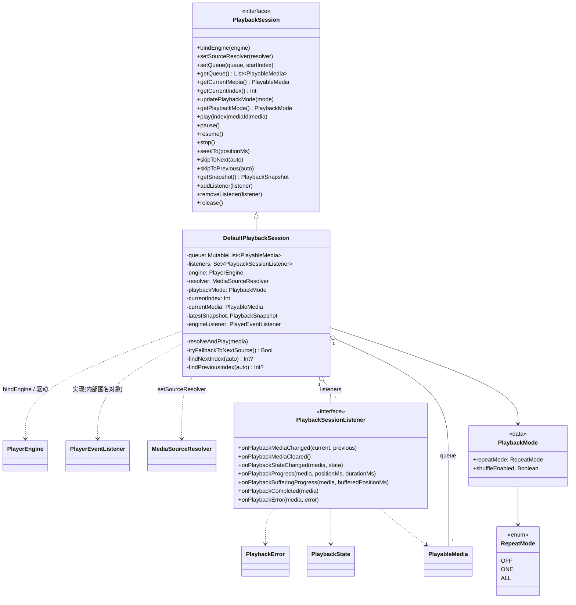
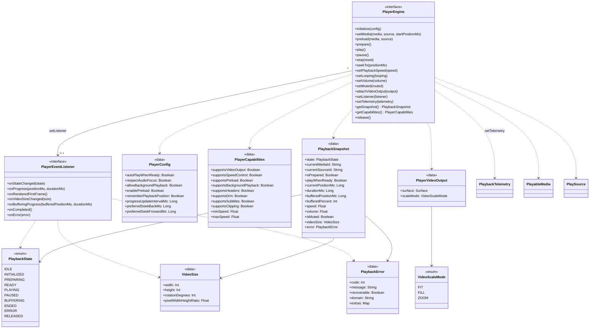
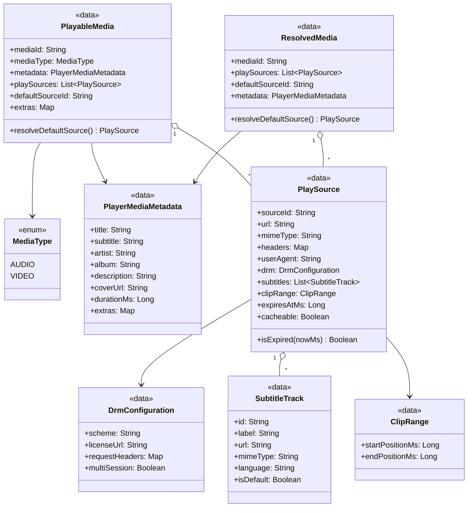
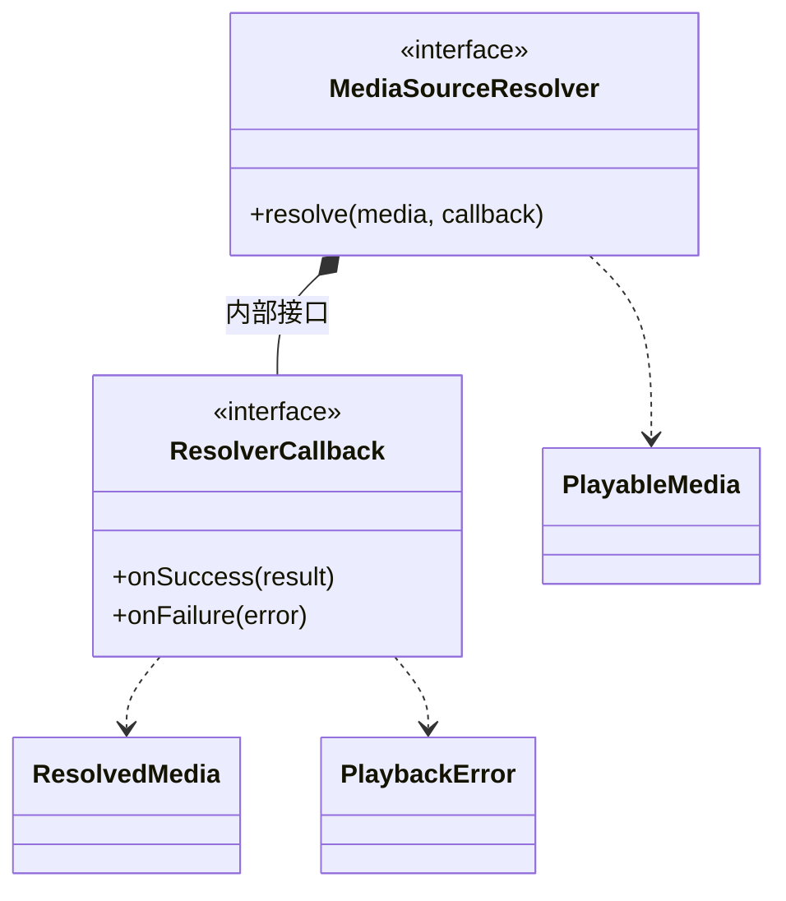
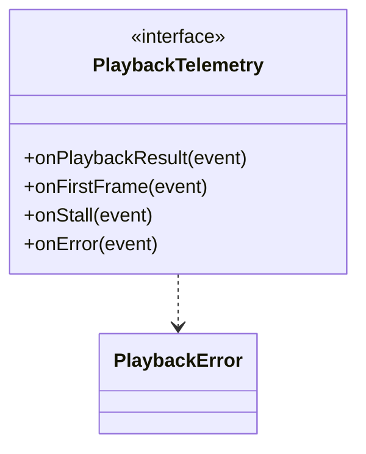

# Protocol Layer Class Diagram

`player-core` 协议层（`engine` / `media` / `source` / `session` / `telemetry`）当前结构的类图快照，用于评审阶段参考。代码才是最终事实来源，本文档若与代码不一致，以代码为准。

## session 包：会话协调层

## engine 包：播放内核协议

## media 包：媒体模型

## source 包：解析边界

## telemetry 包：可观测性协议

## 结构速览

- **engine 包**(底层内核协议):`PlayerEngine` 为核心接口,围绕它的是配置 (`PlayerConfig`)、能力声明 (`PlayerCapabilities`)、运行时快照 (`PlaybackSnapshot` + `PlaybackState`)、事件回调 (`PlayerEventListener`)、视频输出 (`PlayerVideoOutput` + `VideoScaleMode` + `VideoSize`) 和统一错误 (`PlaybackError`)。`PlayerEventListener` 遵循最少知道原则,每个回调只携带该事件必需的最小参数(`onStateChanged(state)`、`onProgress(positionMs, durationMs)`、`onBufferingProgress(bufferedPositionMs, durationMs)`、`onCompleted()`、`onError(error)`);需要完整状态的消费者应自行调用 `PlayerEngine.getSnapshot()` 拉取,`PlaybackSnapshot` 只作为拉取式 API 的返回值,不再作为事件推送负载。
- **media 包**(媒体模型):`PlayableMedia` 持有多条 `PlaySource`,`PlaySource` 又挂载 DRM / 字幕 / 裁剪区间。`ResolvedMedia` 是 resolver 输出的轻量更新结构,与 `PlayableMedia` 共享 `resolveDefaultSource()` 策略(存在重复代码)。
- **source 包**:仅一个边界接口 `MediaSourceResolver`,内嵌 `Callback`,是 session 与业务解析逻辑之间的唯一耦合点。
- **session 包**(会话协调层):`PlaybackSession` 接口 + 唯一实现 `DefaultPlaybackSession`,组合 `PlayerEngine`、`MediaSourceResolver`、队列 (`List<PlayableMedia>`)、`PlaybackMode`(`RepeatMode`)。`PlaybackSessionListener` 本轮同样按最少知道原则收窄:删除了无真实消费者的 `onQueueChanged`/`onPlaybackModeChanged`;`onCurrentMediaChanged(current: PlayableMedia?, previous)` 拆成 `onPlaybackMediaChanged(current: PlayableMedia, previous)`(current 不再可空)+ `onPlaybackMediaCleared()`(专门表达"没有任何选中项了");其余回调(`onPlaybackStateChanged`/`onPlaybackProgress`/`onPlaybackBufferingProgress`/`onPlaybackCompleted`/`onPlaybackError`)都显式携带事件所属的 `PlayableMedia`——这是跟 engine 层不同的地方:engine 一次只认一个 source,"是哪个"没有歧义,但 session 生命周期内会经历多条 media,省略 media 会让只订阅部分回调的消费者丢上下文。`DefaultPlaybackSession` 内部用匿名类实现 `PlayerEventListener` 桥接 engine 事件,大多数回调直接转发 engine 推来的精简参数并附上自己持有的 `currentMedia`,无需反查 `engine.getSnapshot()`;只有 `onError` 内部仍会 `pullSnapshot()`,因为 `tryFallbackToNextSource()` 的降级逻辑需要 `currentSourceId`/`currentPositionMs`,但这只是 session 内部实现细节,不影响对外转发的精简信号。
- **telemetry 包**:`PlaybackTelemetry` 独立可插拔协议,仅依赖 `PlaybackError`,不感知 session/media。
